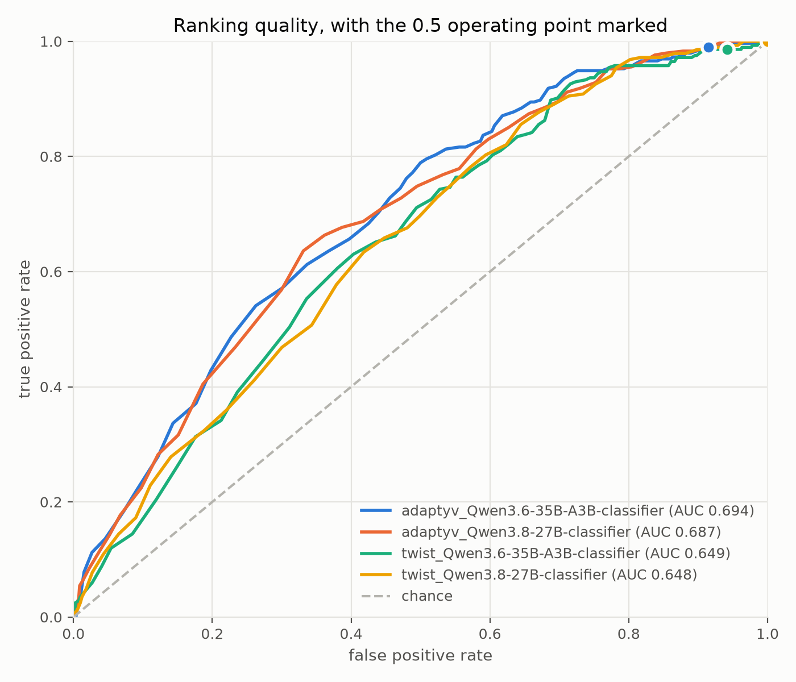
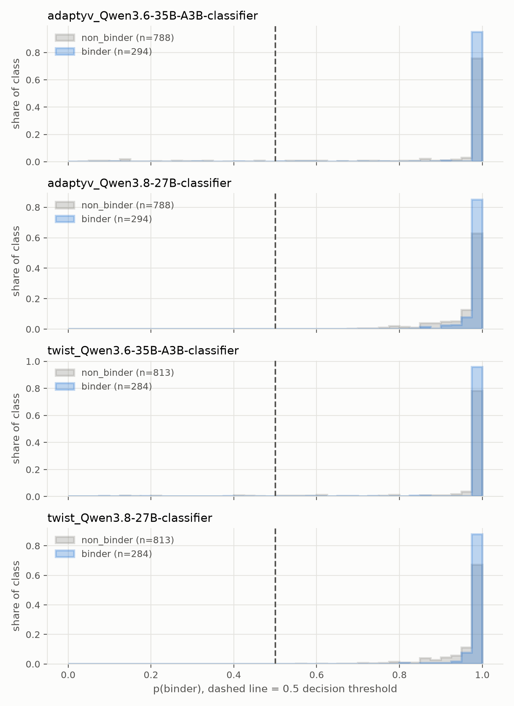

# Zero-shot classification of protein binders

A general-purpose LLM classifier, shown only structure-prediction metrics, ranks AI-designed
protein binders at 0.65-0.69 ROC-AUC against wet-lab binding calls. A single cofolding
metric, binder pLDDT, does better at 0.74. A model trained on the same features reaches 0.86,
but loses almost all of that advantage on an antigen it has not seen.

## Setup

[`Anthropic/claude-protein-binder-design`](https://huggingface.co/datasets/Anthropic/claude-protein-binder-design)
pairs ~1,100 AI-generated binder designs against 15 antigens with wet-lab binding calls from
two labs, Adaptyv and Twist. Every design was cofolded with Boltz-2 several times, producing
interface-quality metrics (ipSAE, sc_DockQ, interface PAE, pLDDT, contact counts).

Each design becomes one row: those metrics aggregated across folding runs
(min/max/mean/std/median), plus target name, generator, design method, binder length, and
epitope size. The row is handed as a JSON state to the Featherless
[Simple Jev](https://featherless.ai) classifier API with one question, "Does the candidate
protein bind the target protein?", and the returned probability is p(binder). No training,
no protein-specific model, no sequence.

Every scorer is then evaluated on the same designs: the zero-shot classifier, supervised
models cross-validated on the same feature table, and each cofolding metric used as a score
on its own.

## Results

### The zero-shot classifier ranks below one column of its own input

Adaptyv labels, Qwen3.8-27B, each scorer at its own best-F1 threshold, supervised models on
out-of-fold predictions:

| scorer | ROC-AUC | balanced accuracy | MCC |
|---|---|---|---|
| logistic regression (5-fold) | 0.861 | 0.781 | 0.540 |
| gradient boosting (5-fold) | 0.854 | 0.782 | 0.544 |
| `plddt_binder_mean` alone | 0.743 | 0.716 | 0.395 |
| `sc_dockq_mean` alone | 0.705 | 0.656 | 0.278 |
| `ipsae_min_mean` alone | 0.701 | 0.672 | 0.308 |
| **zero-shot Jev** | **0.687** | **0.652** | **0.275** |
| `pae_interface_mean_mean` alone | 0.663 | 0.635 | 0.241 |

It sits 0.17 AUC below a trained model and 0.06 below the single best cofolding metric. It
extracts no signal that is not already in one column of what it was shown.

### The trained models are mostly learning per-target base rates

Hold out whole antigens instead of random folds and the supervised edge disappears:

| scorer | AUC, random folds | AUC, held-out antigen |
|---|---|---|
| logistic regression | 0.861 | 0.613 |
| gradient boosting | 0.854 | 0.562 |
| `plddt_binder_mean` alone | 0.743 | 0.743 |
| zero-shot Jev | 0.687 | 0.687 |

On an antigen no model has seen, a single cofolding metric beats everything else here and the
zero-shot classifier beats both trained models. Per-target accuracy ranges from 0.31 (BHRF1)
to 0.88 (Cas9), so target difficulty dominates the result.

### Ranking is usable; the probabilities are not

| run | designs | ROC-AUC | accuracy at p >= 0.5 | binder base rate |
|---|---|---|---|---|
| Adaptyv, Qwen3.8-27B | 1082 | 0.687 | 0.272 | 0.272 |
| Adaptyv, Qwen3.6-35B-A3B | 1082 | 0.694 | 0.331 | 0.272 |
| Twist, Qwen3.8-27B | 1097 | 0.648 | 0.259 | 0.259 |
| Twist, Qwen3.6-35B-A3B | 1097 | 0.649 | 0.298 | 0.259 |

The median score is above 0.99 in every run and the 0.5 cut clears 0-8.5% of non-binders, so
accuracy there sits at or just above the base rate and MCC at or near zero. Every number in
the tables above therefore uses a tuned threshold; accuracy at 0.5 measures the endpoint's
calibration, not its discrimination.





Twist labels tell the same story at lower numbers: trained models at 0.84 AUC, zero-shot at
0.648, below every single-metric baseline except interface PAE. Full tables for all four runs
and both CV schemes are in `results/benchmark_*.csv`.

## Install

```bash
uv venv && uv pip install -e ".[dev]"
```

## Run

```bash
zsbinders features --label adaptyv                  # build and cache the feature table
zsbinders models                                    # classifiers the demo API serves
zsbinders score --label adaptyv --limit 100         # smoke test on a balanced subsample
zsbinders score --label adaptyv --resume            # full run, skipping anything already scored
zsbinders benchmark results/scored_adaptyv_Qwen3.8-27B-classifier.csv
zsbinders benchmark results/scored_adaptyv_Qwen3.8-27B-classifier.csv --by-target
zsbinders report results/scored_adaptyv_Qwen3.8-27B-classifier.csv
zsbinders figures results/scored_*.csv
```

`--label twist` switches to the other lab's calls. `--model` selects any classifier from
`zsbinders models`. The public demo endpoint is rate-limited to 4 requests/second and needs
no key; `--api-key-env FEATHERLESS_API_KEY` switches to the production endpoint.
`notebooks/analysis.ipynb` walks the same analysis interactively.

## Layout

```
src/zsbinders/
  data.py        feature table from the two HuggingFace tables
  jev.py         rate-limited, retrying, threaded client for the classifier API
  baselines.py   cross-validated supervised models and single-metric scores
  evaluate.py    metrics at a fixed and a tuned threshold
  figures.py     ROC curves, score distributions, score-versus-metric panels
  cli.py         command line entry point
results/         scored designs and benchmark tables, committed
figures/         rendered plots, committed
```

Feature tables cache to `data/` and are not committed; rebuild them with
`zsbinders features`.

## Method notes

- Scores come from a live demo API, so exact numbers shift slightly between runs even at a
  fixed seed.
- Thresholds: `@0.5` is the cut the API's own `y_pred` implies. `@best-f1` is tuned on the
  same labels it is scored on, so it is optimistic; it is reported to separate ranking
  quality from calibration, and the two share a ROC-AUC by construction.
- Supervised baselines are scored on out-of-fold predictions. `--by-target` holds out whole
  antigens, which is the harder and more honest setting: stratified folds let a model learn
  each target's base rate.
- Only Boltz-2 cofolding runs are used.

## References

- C. T. Ford, "Zero-Shot Classification of Protein Binders with Jev" (2026),
  https://blog.colbyford.com/zero-shot-classification-of-protein-binders-with-jev-634b0300e58d
- Anthropic, `claude-protein-binder-design`, HuggingFace Datasets, CC-BY-4.0.
